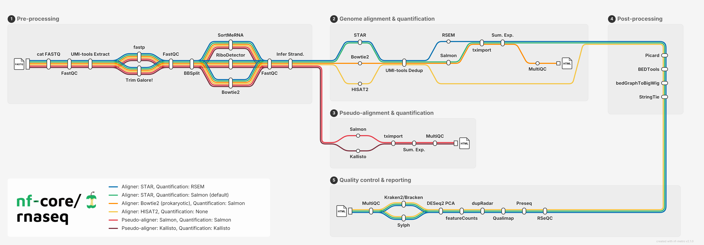
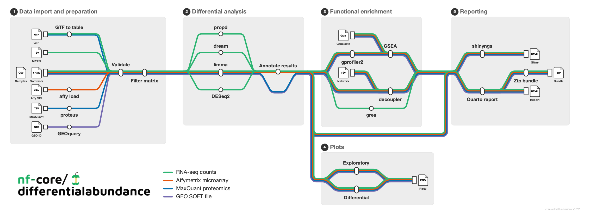

## Introduction

This is a bioinformatics pipeline adapted from ***nf-core/rnaseq** and **nf-core/differentialabundance** that can be used to analyse RNA sequencing data at the [Perkins Cancer Biobank (PCB)](https://perkins.org.au/research/disease/cancer/cancer-biobank/) 
It takes a samplesheet with FASTQ files or pre-aligned BAM files as input, performs quality control (QC), trimming and (pseudo-)alignment, produces a gene expression matrix, QC report, and (TODO) downstream analyses such as differential expressions, gene enrichment analysis and extensive reports for RShiny App and Quarto notebook.

<p align="center">
     
    
</p>


## Usage

> [!NOTE]
> If you are new to Nextflow and nf-core, please refer to [this page](https://nf-co.re/docs/get_started/environment_setup/overview) on how to set-up Nextflow. Make sure to [test your setup](https://nf-co.re/docs/get_started/run-your-first-pipeline) with `-profile test` before running the workflow on actual data.

First, prepare a samplesheet with your input data that looks as follows:

**samplesheet.csv**:

```csv
sample,fastq_1,fastq_2,strandedness,seq_platform
CONTROL_REP1,AEG588A1_S1_L002_R1_001.fastq.gz,AEG588A1_S1_L002_R2_001.fastq.gz,auto,ILLUMINA
CONTROL_REP1,AEG588A1_S1_L003_R1_001.fastq.gz,AEG588A1_S1_L003_R2_001.fastq.gz,auto,ILLUMINA
CONTROL_REP1,AEG588A1_S1_L004_R1_001.fastq.gz,AEG588A1_S1_L004_R2_001.fastq.gz,auto,ILLUMINA
```

Each row represents a fastq file (single-end) or a pair of fastq files (paired end). Rows with the same sample identifier are considered technical replicates and merged automatically. The strandedness refers to the library preparation and will be automatically inferred if set to `auto`. The `seq_platform` column is optional; for a single platform across all samples, use the `--seq_platform` parameter instead.

The pipeline supports a two-step reprocessing workflow using BAM files from previous runs. Run initially with `--save_align_intermeds` to generate a samplesheet with BAM paths, then reprocess using `--skip_alignment` for efficient downstream analysis without repeating expensive alignment steps. This feature is designed specifically for pipeline-generated BAMs.

> [!WARNING]
> Please provide pipeline parameters via the CLI or Nextflow `-params-file` option. Custom config files including those provided by the `-c` Nextflow option can be used to provide any configuration _**except for parameters**_; see [docs](https://nf-co.re/docs/running/run-pipelines#using-parameter-files).

Now, you can run the pipeline using:

```bash
nextflow run nf-core/rnaseq \
    --input <SAMPLESHEET> \
    --outdir <OUTDIR> \
    --gtf <GTF> \
    --fasta <GENOME FASTA> \
    -profile <docker/singularity/.../institute>
```

For more details and further functionality, please refer to the [usage documentation](https://nf-co.re/rnaseq/usage) and the [parameter documentation](https://nf-co.re/rnaseq/parameters).

## Pipeline output

To see the results of an example test run with a full size dataset refer to the [results](https://nf-co.re/rnaseq/results) tab on the nf-core website pipeline page.
For more details about the output files and reports, please refer to the
[output documentation](https://nf-co.re/rnaseq/output).

This pipeline quantifies RNA-sequenced reads relative to genes/transcripts in the genome and normalizes the resulting data. It does not compare the samples statistically in order to assign significance in the form of FDR or P-values. For downstream analyses, the output files from this pipeline can be analysed directly in statistical environments like [R](https://www.r-project.org/), [Julia](https://julialang.org/) or via the [nf-core/differentialabundance](https://github.com/nf-core/differentialabundance/) pipeline.

## Credits

These scripts were originally written for use at the [National Genomics Infrastructure](https://ngisweden.scilifelab.se), part of [SciLifeLab](http://www.scilifelab.se/) in Stockholm, Sweden, by Phil Ewels ([@ewels](https://github.com/ewels)) and Rickard Hammarén ([@Hammarn](https://github.com/Hammarn)).


## Contributions and Support


## Citations

If you use nf-core/rnaseq for your analysis, please cite it using the following doi: [10.5281/zenodo.1400710](https://doi.org/10.5281/zenodo.1400710)

An extensive list of references for the tools used by the pipeline can be found in the [`CITATIONS.md`](CITATIONS.md) file.

You can cite the `nf-core` publication as follows:

> **The nf-core framework for community-curated bioinformatics pipelines.**
>
> Philip Ewels, Alexander Peltzer, Sven Fillinger, Harshil Patel, Johannes Alneberg, Andreas Wilm, Maxime Ulysse Garcia, Paolo Di Tommaso & Sven Nahnsen.
>
> _Nat Biotechnol._ 2020 Feb 13. doi: [10.1038/s41587-020-0439-x](https://dx.doi.org/10.1038/s41587-020-0439-x).
